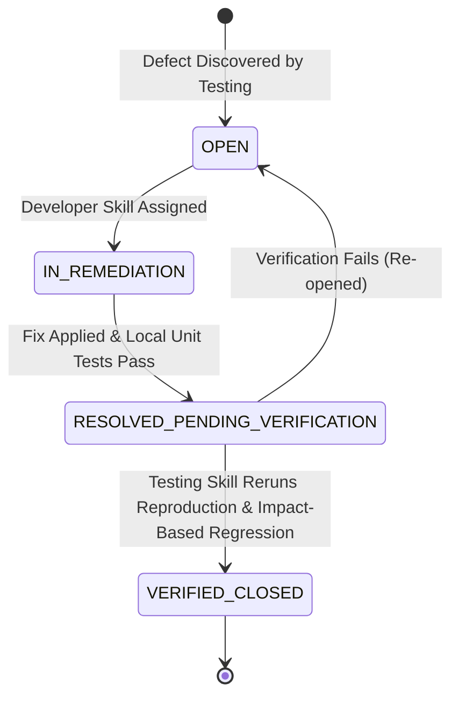

# APEX Closed-Loop Defect Handoff Contract

**Document type:** Process & Data Contract  
**Purpose:** Standardizes the defect handoff between Testing Skill and Developer Skill with closed-loop verification.

---

## 1. Defect Lifecycle State Machine



---

## 2. Standard Defect Report Schema

When a defect is identified by the Testing Skill, it MUST be reported using this machine-readable Markdown structure:

```markdown
### DEFECT-[YYYYMMDD]-[SEQ]: [Concise Title]
- **Severity:** [CRITICAL | HIGH | MEDIUM | LOW]
- **Component:** [File path or module name]
- **Detected By:** [e.g. Negative Testing Agent / Integration Testing Agent]
- **Status:** OPEN

#### Preconditions
- [Environment state, configurations, or seed data]

#### Reproduction Command & Steps
1. Run command:
   ```bash
   [Exact terminal command or script]
   ```
2. Payload / Input:
   ```json
   { "key": "invalid_value" }
   ```

#### Observed vs Expected Behavior
- **Expected:** [HTTP 400 Bad Request with error message "Invalid ID"]
- **Observed:** [HTTP 500 Internal Server Error with an unhandled NullReferenceException]

#### Raw Terminal Evidence
```text
[Paste redacted terminal trace or error output]
```
```

---

## 3. Developer Remediation Protocol

1. **Intake:** Developer Skill receives the defect with reproduction command.
2. **Diagnosis:** `debugging-agent` confirms reproduction using the exact command provided.
3. **Targeted Fix:** `remediation-agent` applies a minimal fix in source code.
4. **Local Check:** `unit-testing-agent` adds or identifies a focused regression test and verifies its result.
5. **Handoff for QA Verification:** Mark defect status as `RESOLVED_PENDING_VERIFICATION`.

---

## 4. Post-Fix QA Verification Protocol

1. **Reproduction Re-execution:** Testing Skill executes the original reproduction command or a valid equivalent.
2. **Assertion Check:** Verify observed behavior now matches expected behavior and the intended assertions executed.
3. **Impact-Based Regression:** `regression-testing-agent` runs targeted checks first, then dependent, critical, and broader suites as required by change risk, policy, and release criteria.
4. **Closure:**
   - If the reproduction passes and required regression evidence supports closure, mark `VERIFIED_CLOSED`.
   - If the reproduction fails or relevant regressions appear, reopen the defect with new evidence.
